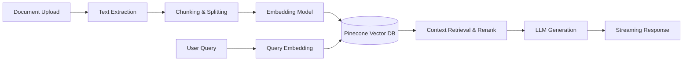

<div align="center">
  <h1>InsightFlow AI</h1>
  <p><em>Your Intelligent Context-Aware RAG Engine</em></p>

  [](https://www.python.org/)
  [](https://fastapi.tiangolo.com/)
  [](https://nextjs.org/)
  [](https://www.docker.com/)
  [](https://opensource.org/licenses/MIT)
</div>

## Project Overview

**InsightFlow AI** is a full-stack Retrieval-Augmented Generation (RAG) platform designed to ingest, chunk, embed, and query complex enterprise documents. It leverages state-of-the-art LLMs (OpenAI, Gemini), vector databases (Pinecone), and robust backend orchestration (LangChain/LangGraph) to answer questions over uploaded documents with cited context. 

With InsightFlow AI, teams can chat with their data repositories, trace generation flows (LangSmith), track evaluation metrics (MLflow), and securely scale across AWS via a fully automated CI/CD pipeline.

## Features

- **Multi-Modal Document Processing**: Upload PDFs, DOCX, TXT, CSV, and Markdown.
- **Advanced RAG Pipeline**: Intelligent chunking, overlap control, semantic search, and re-ranking.
- **Provider Agnostic**: Switch seamlessly between OpenAI and Google Gemini.
- **Streaming Chat**: Real-time Server-Sent Events (SSE) for fluid conversation.
- **Document Comparison**: Ask questions across multiple documents simultaneously.
- **Automated Summarization**: One-click summary generation for long documents.
- **Telemetry & Tracing**: Full LangSmith integration for debugging LangChain runs.
- **Experiment Tracking**: Built-in MLflow logging for evaluation datasets and metrics.
- **Secure Authentication**: JWT-based auth with Role-Based Access Control (RBAC).
- **Enterprise Scale Infrastructure**: Docker Compose for local dev, AWS ECS/Fargate for prod.

## Tech Stack

| Category | Technologies |
|---|---|
| **Frontend** | Next.js 14, TypeScript, Tailwind CSS |
| **Backend** | Python 3.11, FastAPI, SQLAlchemy, asyncpg |
| **AI / Orchestration** | LangChain, LangGraph, OpenAI, Google Gemini |
| **Databases** | PostgreSQL 15, Redis 7 (Caching & Pub/Sub), Pinecone (Vector DB) |
| **Observability** | MLflow, LangSmith |
| **DevOps** | Docker, GitHub Actions, AWS ECS/ECR/ALB |

## System Architecture

### RAG Pipeline


### Infrastructure Layout
- **VPC** in AWS with public/private subnets.
- **ALB** distributing traffic to ECS Fargate tasks (Frontend & Backend).
- **S3** for raw document storage.
- **RDS (PostgreSQL)** for application state.
- **ElastiCache (Redis)** for session caching and chat history.

## Evaluation

Retrieval is measured offline on a public dataset, with confidence intervals and error
analysis. Details, commands and caveats: [`backend/benchmarks/README.md`](backend/benchmarks/README.md).

**SQuAD v1.1 dev, all 2,067 paragraphs, one question each** (95% bootstrap CI):

| Config | Recall@1 | Recall@5 | MRR@10 |
|---|---|---|---|
| BM25 (stand-in for Postgres full-text search) | 0.780 [0.761, 0.797] | 0.926 [0.915, 0.937] | 0.843 [0.830, 0.856] |
| Dense (local BGE-small embeddings) | 0.684 [0.664, 0.703] | 0.895 [0.881, 0.908] | 0.773 [0.757, 0.788] |
| Hybrid (RRF) | 0.766 [0.748, 0.784] | 0.945 [0.935, 0.955] | 0.846 [0.833, 0.859] |
| Hybrid + lightweight reranker | **0.782** [0.764, 0.800] | **0.947** [0.937, 0.956] | **0.854** [0.842, 0.867] |

- Hybrid beats either retriever alone: +0.019 Recall@5 over BM25 (p < 0.001), and true misses
  drop from 50 to 29.
- Dense alone is worse than BM25 here, because SQuAD questions reuse the paragraph's words.
  This favours keyword search, so a second dataset is the next run.
- RRF improves coverage but not ordering; the reranker restores ordering (MRR +0.011, p = 0.04).
- Embeddings recovered the misspelled-word misses ("platycenida", "Cypiddids"). Most remaining
  misses are context-dependent questions ("What did this agreement do?").
- **Unanswerable questions (SQuAD 2.0):** retrieval scores cannot flag them (AUROC 0.576 over
  2,408 questions). With Gemini Flash-Lite, the original prompt **hallucinated on 22.7–30.0% of
  unanswerable questions** (two samples of 300, reviewed by hand). Nearly all of these answered a
  nearby true fact and missed a changed name, date or "not". A detail-checking prompt cut this to
  **9.3–14.7%** (paired p < 0.001 on both). It was confirmed on a fresh sample it was not
  designed on, and is now the production prompt. The cost: more over-cautious "not found" replies
  (4.2% → 12.5% of answerable questions). Most of those still state the answer.

An earlier evaluation reported 1.0 on nearly every metric. It used 10–15 hand-written questions
over 5 documents, and its faithfulness score was inflated word overlap. It is kept, with that
explanation, in [`docs/legacy_results/`](docs/legacy_results/). The inflation in the app's
metrics is fixed: the generation scores are now labelled as lexical proxies, and Recall@K no
longer returns 1.0 when a question has no ground truth.

## Quick Start

1. **Clone the repository**
   ```bash
   git clone https://github.com/Varun18-hub-dev/InsightFlow_AI.git
   cd InsightFlow_AI
   ```

2. **Initialize Environment**
   ```bash
   bash scripts/setup.sh
   ```
   *This copies `.env.example` to `.env`.*

3. **Configure API Keys**
   Open `.env` and add your keys:
   - `PINECONE_API_KEY`
   - `GEMINI_API_KEY` (or `OPENAI_API_KEY`)

4. **Start the Stack**
   ```bash
   docker compose up -d --build
   ```

5. **Seed the Database (Optional)**
   ```bash
   docker exec -it insightflow-backend python /app/scripts/seed_db.py
   ```

Access the UI at `http://localhost:3000` and API docs at `http://localhost:8000/docs`.

## Local Development Setup

We recommend using Docker Compose to spin up Postgres, Redis, and MLflow, then running the Backend and Frontend locally for live-reloading.

**Backend**:
```bash
cd backend
python -m venv .venv
source .venv/bin/activate
pip install -r requirements.txt
uvicorn app.main:app --reload
```

**Frontend**:
```bash
cd frontend
npm install
npm run dev
```

## Environment Variables

| Variable | Required | Description |
|---|---|---|
| `DATABASE_URL` | Yes | Postgres connection string |
| `REDIS_URL` | Yes | Redis connection string |
| `SECRET_KEY` | Yes | JWT signing key |
| `LLM_PROVIDER` | Yes | `openai` or `gemini` |
| `PINECONE_API_KEY` | Yes | Vector DB key |
| `MLFLOW_TRACKING_URI` | No | URI for MLflow server |
| `LANGCHAIN_API_KEY` | No | LangSmith API key |

*(See `.env.example` for the complete list.)*

## Docker Setup

The `docker-compose.yml` file orchestrates 5 services:
- **postgres**: Relational data (users, document metadata).
- **redis**: Cache and message broker.
- **mlflow**: Local ML experiment tracking UI on port 5001.
- **backend**: FastAPI application.
- **frontend**: Next.js application.

## API Reference

| Method | Endpoint | Description |
|---|---|---|
| POST | `/api/auth/register` | Register new user |
| POST | `/api/auth/login` | Authenticate and get JWT |
| POST | `/api/documents/upload` | Upload and process file |
| GET | `/api/documents` | List user documents |
| POST | `/api/chat` | RAG query |
| POST | `/api/chat/stream` | RAG query (SSE streaming) |
| POST | `/api/evaluations/run` | Trigger evaluation job |

## Testing

Run unit and integration tests:
```bash
bash scripts/run_tests.sh
```

Run the offline retrieval benchmark (no keys or database needed):
```bash
cd backend
python -m benchmarks.run_retrieval_benchmark --configs bm25,bm25+light
```

Run the API-level evaluation (requires DB and backend running):
```bash
cd evaluation
python run_evaluation.py --api-url http://localhost:8000
```

## MLflow Usage
Evaluations are logged to MLflow if `MLFLOW_TRACKING_URI` is set. 
Visit `http://localhost:5001` to view your `RAG_Evaluation` experiments, comparing Recall, Precision, and Relevance across different chunking sizes and LLM models.

## LangSmith Usage
Set `LANGCHAIN_TRACING_V2=true` and `LANGCHAIN_API_KEY` in `.env`. LangSmith will automatically record all LangChain components, agent steps, and LLM input/output for debugging complex RAG workflows.

## AWS Deployment
Deployment to AWS ECS Fargate is automated via GitHub Actions (`.github/workflows/cd.yml`).
For manual deployment or initial setup:
```bash
bash infrastructure/aws/deploy.sh production
```
See `infrastructure/aws/README.md` for complete VPC and ECS prerequisite setup.

## Known Limitations / Current State
- The cross-encoder reranker and a second, harder dataset (BEIR SciFact) are not yet benchmarked.
- About 1 in 7 unanswerable questions still gets a confident wrong answer with the current prompt, and about 1 in 8 answerable questions gets an over-cautious "NOT FOUND:" reply (usually still containing the answer). Both are measured in `backend/benchmarks/README.md`.
- The in-app `faithfulness` and `answer_relevance` scores are word-overlap proxies, not LLM or
  human judgements. Use `benchmarks/run_generation_benchmark.py` (SQuAD exact match / F1) for answer quality.
- Follow-up questions are not rewritten with chat history before retrieval; the benchmark's error
  analysis shows this is a real failure mode.
- Document processing currently supports files up to 50MB.
- Real-time OCR for scanned PDFs is experimental.
- Local LLM inference (e.g., Ollama) is not yet supported.

## Future Improvements
- [ ] Implement GraphRAG for complex multi-hop entity relationships.
- [ ] Add support for Anthropic Claude 3 models.
- [ ] Integrate local embedding options (SentenceTransformers) to reduce API costs.
- [ ] Rewrite follow-up questions using chat history before retrieval.
- [ ] Benchmark the cross-encoder reranker, and all configs on BEIR SciFact.

## Contributing
1. Fork the repo.
2. Create your feature branch (`git checkout -b feature/amazing-feature`).
3. Commit your changes (`git commit -m 'Add amazing feature'`).
4. Push to the branch (`git push origin feature/amazing-feature`).
5. Open a Pull Request.

## License
Distributed under the MIT License. See `LICENSE` for more information.
